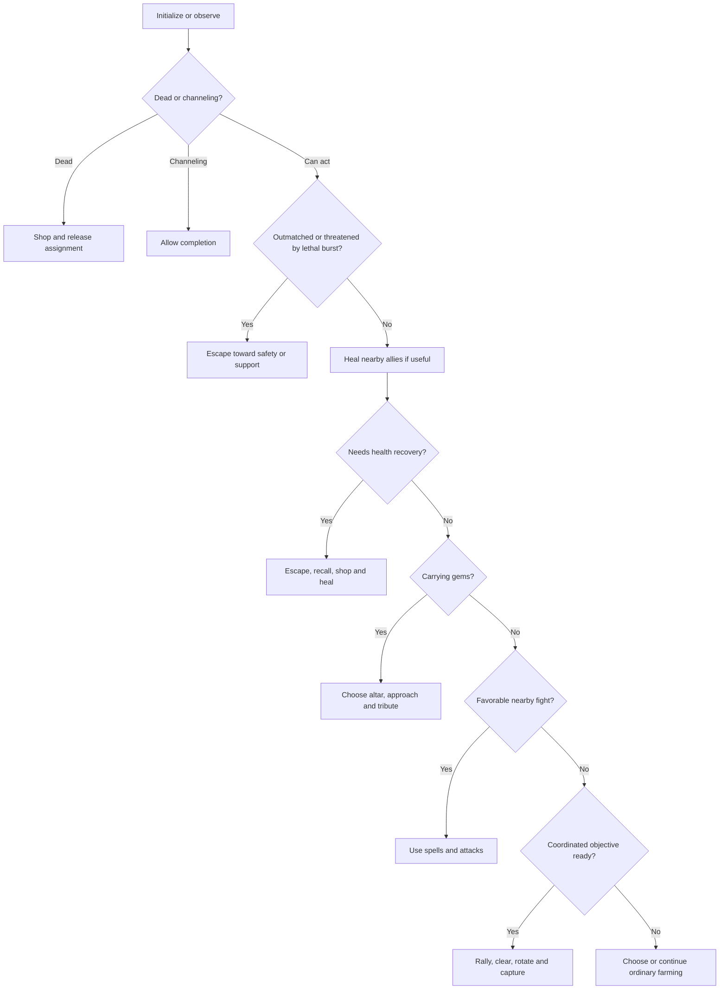

# Bot1 strategy v2

This revision implements plans derived from the 15 supplied lobby recordings, replayed with the official engine 0.0.3. The [match analysis](../../match-data/analysis/REPORT.md) concerns the original bot. Earlier match results do not measure this revision.

## Plans and implementation

| Observed failure | New behavior |
| --- | --- |
| Varg and Vendetta held 66 gems without moving for hundreds of rounds | Camp danger uses actual awake state. Movement plans complete routes around danger, with escape routes, congestion recovery, and altar replanning. |
| Small-map fights caused repeated deaths and gem transfers | Compare nearby teams, estimate ready spells and dash reach, require a larger advantage for carriers, and escape before the predicted burst can kill. |
| Gold farming never became a monolith clear | Draft Willow, organize a gold opening and shared rally, assess committed allies' damage and survival, heal and rotate tanks, then assign capture and tribute. |
| A 964–1,004 loss ended with gems still in transit | Prioritize banking, estimate the complete delivery cycle, favor camps that can score before the deadline, and skip optional late shopping trips. |
| Tavi farmed gold but contributed no gems on rows | Consider helping a live gem camp alongside solo camp choices, including nearby helper availability and reward splitting. |

## Rules and budgets

Only submitted gems count toward the win. Camp rewards require clearing every member and holding the region through capture. Extra champions split the reward without speeding capture. Channels finish at a later owner turn start, after their countdown reaches zero.

Each champion still has one persistent instance and its own vision. Live state is never inferred from a teammate's private view. Immutable geometry, camp metadata, roster handles, and altar distance fields are cached. Decisions use native bitboards and distance fields. Fuel guards preserve room for actions and turn yielding; new fuel consumption has not yet been measured in matches.

## Map-dependent draft

| Map classification | First five preferences |
| --- | --- |
| Spacious map | Tavi, Varg, Vendetta, Ryth, Vesper Vale |
| Spacious map with many packs | Varg, Tavi, Vendetta, Ryth, Vesper Vale |
| Potentially contested map | Varg, Tavi, Marcella, Ryth, Ren |
| Monoliths supply all camp gems | Varg, Willow, Tavi, Vendetta, Ryth |

A map is classified as potentially contested if its longest side is at most 65 tiles or the spawn corners are at most 42 Chebyshev tiles apart. This is a geometry heuristic. The monolith classification overrides it. Picks remain unique, and draft memory records strategy version 2 and the map flags.

Varg retains splash clearing and shields. Compact-map picks add health, control, and Marcella's stun immunity. Willow supplies allied healing on monolith maps. Cassi & Issac remain a future draft experiment; this revision does not make their linked survival the default.

## Turn priorities

After respawning, champions temporarily favor nearby camps and delay rejoining a monolith rally. Spawn healing is allowed to finish before departure. Existing channels are preserved; the current safety assessment governs whether to start them.

## Navigation and carrying gems

Awake camp threats come from `camp::is_awake()`, current strength, and attack range. Missing health does not imply aggression. The selected farm camp is allowed during deliberate clearing; unrelated awake camps and enemy threat ranges are avoided during travel.

The route planner first computes a complete distance field with danger regions blocked. This permits detours whose initial steps increase geometric distance to the destination. If the champion starts inside danger, it can route toward the safe component connected to its goal. When safe routing is unavailable it relaxes the route, and prolonged congestion permits a lateral step with bounded local danger.

Carriers choose altars using cached walking distances and visible approach risk. Repeated lack of progress temporarily penalizes the chosen altar and triggers replanning. If tribute is refused, the current unsafe tile is removed from the navigation goals. Banking and retreat both have progress recovery.

Banking precedes optional fights. Adjacent enemy locks are attacked; tribute starts when projected exposure fits the health reserve. Dashes can cross holes with legal landings and fresh occupancy checks. Teleport crystals remain available for useful shortcuts, and hidden occupant failures permit another movement attempt.

## Combat and recovery

Visible fighters are compared using weighted nearby health, estimated damage, available spell burst, healing, and numbers. Enemy threat reach includes ready damage/control spells and dashes. Visible cooldowns are queried; immutable spell metadata comes from champion designs, avoiding cached hidden-enemy metadata. Enemy positions remain a conservative threat for three rounds after vision is lost.

A carrier requires a larger estimated advantage than an empty champion. If enemy burst threatens the reserve or the local fight is unfavorable, the champion releases its camp, avoids that target temporarily, and escapes toward spawn or a nearby healthy ally in safety. Escape movement takes precedence over optional attacks. A safe final basic attack can finish an exposed low-health enemy after moving.

Offensive spells respect the shared cast allowance and movement exclusions. Area spell value counts the relevant enemy champions during PvP. Varg can shield before spending the cast on an attack reset when tanking a dangerous camp. Willow selects a visible ally with useful missing health, prioritizing critical patients.

Ordinary recovery begins earlier than v1. Recall also checks whether a known enemy could reach during its channel, and a champion waits for healing after returning to spawn.

## Monolith coordination

The first 150 rounds are reserved for the gold opening. Champions return to buy equipment at a lower gold threshold on these maps. A healthy champion can then advertise a monolith objective for the team.

Shared memory uses bytes 0–5 for individual assignments, byte 6 for the objective index, and byte 7 for a round stamp. An objective lease expires after 40 rounds without refresh. Group indices 0–253 are representable; ordinary solo selection also supports larger indices. Team-objective coordination is limited to representable indices.

Participants approach a staging ring four tiles from the monolith, outside its attack range. The planner counts healthy, visible allies near the objective whose assignments confirm their commitment. It estimates remaining clear time, combined usable health, camp mitigation, sustained healing, and shielding. Most of the squad must gather before beginning; continuing an existing fight has a separate survival check.

Willow stays at healing distance. Wounded participants leave camp range so healthy allies can take over. A rally that remains unsafe for 24 rounds dissolves, and champions return to farming for a 45-round backoff before trying again. Legitimate staging and capture waits are exempt from ordinary stuck-target recovery.

After the clear, an existing occupant keeps capture responsibility; otherwise a deterministic nearby champion approaches. Other participants can resume farming. The carrier then follows normal banking priority. Observations of a respawn restore full camp estimates, preventing remembered zero health from making a fresh camp look safe.

## Equipment and delivery timing

Strength-based farmers first build Monster Strength; Willow and spell-focused champions use Focus. On contested and monolith maps, safe shopping adds a Durability Health emblem before continuing Jungle equipment. Later purchases add health and damage; Tavi also adds Focus for his stun spell. Health purchases occur where healing is available, including dead shopping. Opening camp income is spent on equipment before optional crystals.

Once either team reaches 80% of the winning score, gem delivery dominates camp value. Selection estimates travel, clearing, capture, altar travel, and tribute. A smoothed sample of the opponent's public score growth supplies a tentative finish deadline; late deliveries receive a penalty. Camps that cannot produce score before the actual round limit are rejected. Gold work remains a fallback and stays available for the monolith opening. Optional shopping trips are suppressed during ordinary-map finishing races.

## Artifacts and current evidence

- `Bot1-v2.zip`: versioned source submission for upload.
- `Bot1-v2.wasm`: compiled revision.
- `Bot1.zip` and `Bot1.wasm`: current source bundle and compiled bot.
- `Bot1-v1.zip` and `Bot1-v1.wasm`: preserved original artifacts.
- `src/main.cpp`: version banner, error context, turn yielding and fuel-spill messages.
- `src/draft.cpp`, `src/bot.h`, `src/bot.cpp`: strategy implementation.

The build uses CAMBC/SDK 2.2.5. No new match simulations or tests have been run for v2. The original 18/18 starter result and supplied lobby results belong to v1. New drafts, combat thresholds, route fallbacks, and monolith survival estimates remain heuristics whose match performance must be evaluated.

Banking replans, new objective rallies, and failed rally estimates produce concise stdout diagnostics for the next match review.
